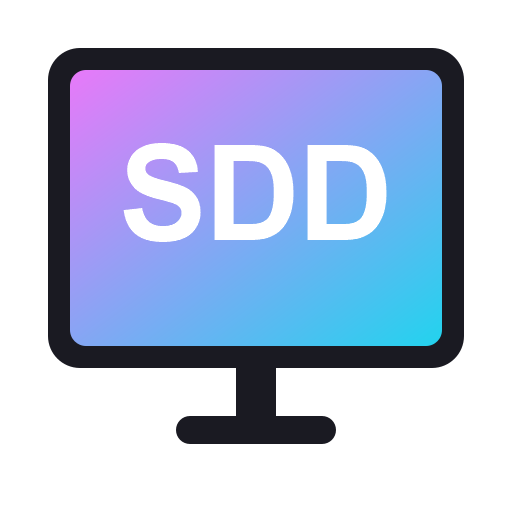
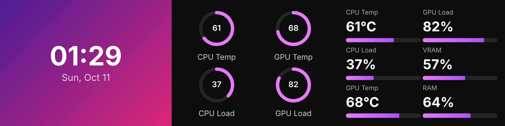
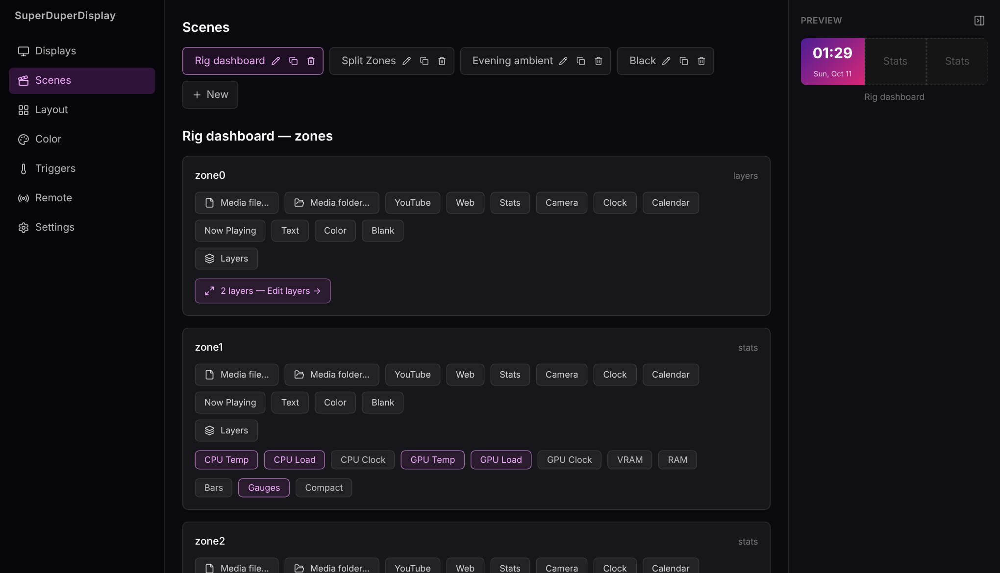
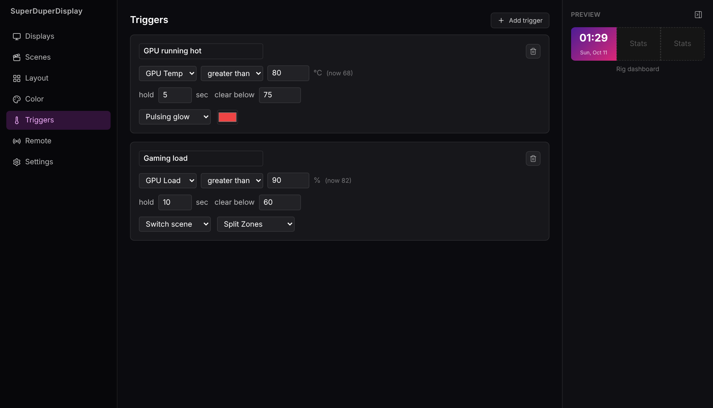
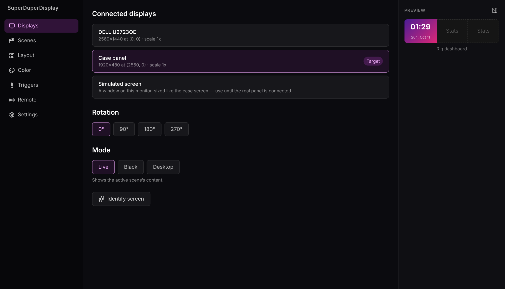
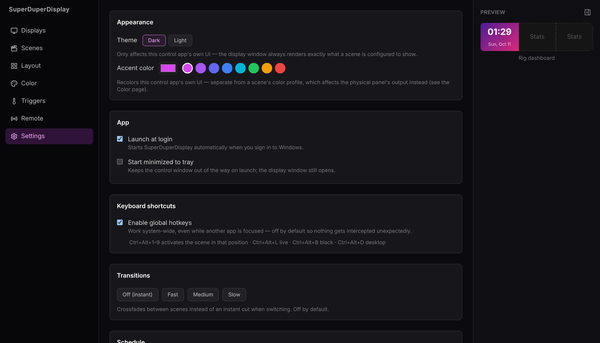

<p align="center"></p>

# SuperDuperDisplay

**Turn the spare screen in your PC case into a live dashboard.**

[**⬇ Download the beta**](https://github.com/zedhand/SuperDuperDisplay/releases) ·
[Website](https://zedhand.github.io/SuperDuperDisplay/) ·
[Report a bug](https://github.com/zedhand/SuperDuperDisplay/issues)

> 🧪 **Beta.** SuperDuperDisplay (formerly MiniDisplay) is in public beta on Windows. Every
> feature below works, but expect rough edges. Bug reports are very welcome. Existing MiniDisplay
> setups are carried over automatically on first launch.



## Getting started

1. Grab the latest `superduperdisplay-<version>-setup.exe` from the
   [releases page](https://github.com/zedhand/SuperDuperDisplay/releases) and run it.
   The installer isn't code-signed yet, so Windows SmartScreen may warn you: choose
   **More info → Run anyway**.
2. On the **Displays** page, pick the screen in your case (or use **Simulated screen** to try it
   without one).
3. Build a scene on the **Scenes** page and watch it appear in the live preview.

## What it is

An Electron app that turns a spare panel — a case-mounted screen, an old monitor, whatever's
bolted to the side of the rig — into a live secondary display, driven from a control window on
your main monitor. The display window targets whichever screen you point it at (by resolution
match or manual pick), and a simulate mode lets you preview layouts without a second screen
plugged in at all.

Content is arranged into resizable zones on a layout, and each zone — or, inside a **layers**
zone, each freely placed/scaled/stacked item, OBS Scenes-style — shows one of:

- **Local media** — a single file or a folder playlist, with shuffle, timed rotation, and
  seamless looping. Broad container support (MKV/AVI/MOV/WMV/and more, not just MP4/WebM) via
  an on-demand ffmpeg normalize step.
- **YouTube** or an arbitrary **web page/dashboard**, embedded, each with its own volume control
- **Live hardware telemetry** — CPU/GPU temp, load, clock, VRAM, RAM — via LibreHardwareMonitor,
  `nvidia-smi`, or `systeminformation`, rendered as bars, gauges, or a compact readout
- **A camera feed** — a USB webcam via `getUserMedia`, or an RTSP camera bridged through ffmpeg
  into something Chromium can actually display
- **Clock** and **calendar** — a live clock, and a calendar that's either a self-contained local
  month grid or a real upcoming-events agenda from a subscribed `.ics` feed URL (no OAuth, no
  stored account credentials — just a calendar provider's own "secret address" export)
- **Now playing** — whatever's currently playing in _any_ app on the machine (a browser tab,
  Spotify, anything with a media session), read straight from Windows' own now-playing info
- **Text** and **solid/gradient color** — for labels, name plates, or a plain background
- **Layers** — an OBS Scenes-style freeform canvas: place, scale, and stack any of the above
  (including another layers zone) at arbitrary positions/sizes within one zone, with per-layer
  opacity, z-order, and visual filters (grayscale/sepia/blur/invert)

## What it does for you

**🖼️ Live preview** — A collapsible preview pane in the control window renders the actual active
scene, live and scaled down, so every editing page is WYSIWYG instead of editing config blind.

**🎨 Layout & color** — Drag-to-resize zones on a layout, and a full color-correction pipeline
(brightness/contrast/saturation/hue/gamma) per profile, so the panel looks right regardless of
what it's mounted next to. Optional crossfade transitions when switching scenes instead of a
hard cut.

**🌡️ Triggers & scheduling** — React to a metric crossing a threshold (GPU temp, CPU load, etc.)
with a pulsing glow overlay, a one-shot flash, or an automatic scene switch — with hold time and
hysteresis so a trigger doesn't flap on and off at the edge of its threshold. Separately, a
time-of-day scheduler can switch scenes on a clock/calendar basis (e.g. stats during work hours,
ambient loops in the evening).

**⌨️ Global hotkeys** — Optional system-wide shortcuts (Ctrl/Cmd+Alt+1-9 for scenes, +L/B/D for
live/black/desktop mode) that work even while the control window isn't focused.

**🔌 Power-aware** — Syncs with Windows lock/suspend/idle so the display blanks itself when you
step away, instead of burning in a frozen frame.

**🗂️ Tray-first** — Lives in the system tray with quick scene/mode switching, minimize-to-tray,
and launch-at-login, so it's just running whenever the machine is.

**📱 LAN remote** — A small QR-code-paired web remote, served over your local network, to switch
scenes or blank/unblank the display from a phone without walking back to the desk. Not exposed
to the internet, and gated behind a token that regenerates on demand.

**🧩 Scene management** — Rename, duplicate, or delete scenes and layouts from the UI, with a
one-level undo for destructive deletes. A "Recent" quick-pick remembers previously-used media
files so you're not always starting from the OS file dialog. Export/import the whole config
(scenes, layouts, color profiles, triggers, schedule) as a single JSON file.

**🌗 Theming** — An accent-color picker and a light/dark toggle for the control app's own chrome
(the display output itself always renders exactly what a scene is configured to show).

## Screenshots

| Scenes and zones                                        | Triggers                                                |
| ------------------------------------------------------- | ------------------------------------------------------- |
|      |  |
| **Display targeting**                                   | **Settings**                                            |
|  |  |

## For developers

SuperDuperDisplay is an Electron app written in TypeScript, with a dual-window architecture: a control
window (React, runs on your main monitor) and a display window (the actual output, targeted at
the secondary panel).

- **UI:** React + Tailwind, two separate renderer bundles (`control`, `display`) sharing types
  from `src/shared`. The layers canvas editor and the live preview pane both render through the
  same `ZoneRenderer` component the display window itself uses, not a second rendering pipeline.
- **Main process:** display targeting/matching, config persistence (`electron-store`), hardware
  telemetry polling, a metric-threshold trigger engine, a time-of-day scheduler, global hotkeys,
  Windows power-event sync, system tray, an RTSP→MJPEG bridge and on-demand video-format
  normalization (both via `ffmpeg-static`), a `.ics` calendar-feed fetcher (`node-ical`), a
  Windows "now playing" bridge (PowerShell/WinRT, no native addon), and a LAN remote server
  (`express` + `ws`)
- **IPC:** a typed channel contract in `src/shared/ipc.ts` shared between main and both preload
  scripts, so a renderer's `window.control`/`window.display` calls are type-checked end to end
- **Build:** `electron-vite`, `electron-builder`

### Building

```bash
npm install
npm run dev          # run in development
npm run build:win     # production build + installer (also :mac, :linux)
```

### Testing

```bash
npm run typecheck    # tsc, both the node and web tsconfigs
npm run lint         # eslint
npm test             # vitest
```

## License

All rights reserved.
